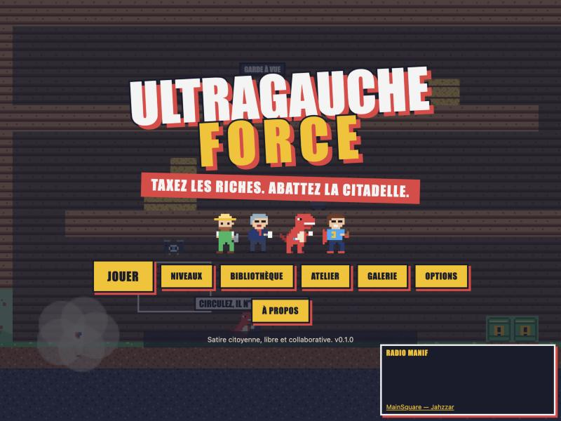
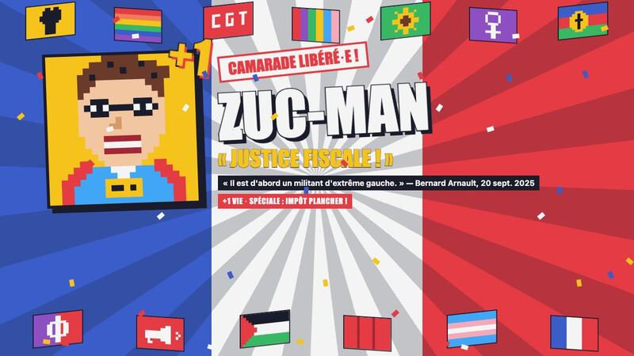
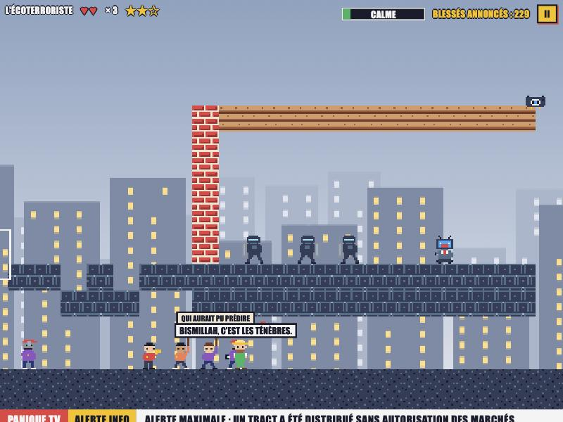
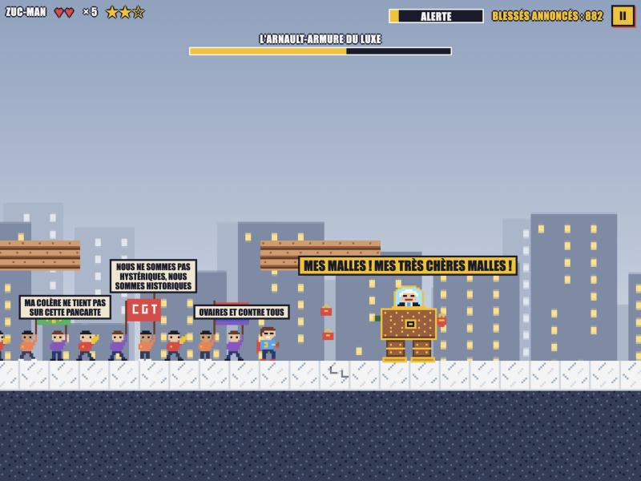
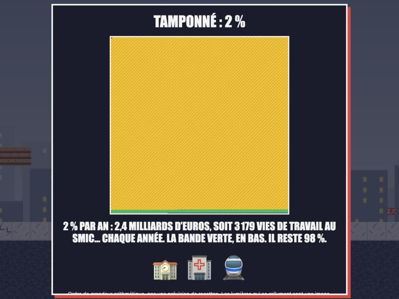

# UltraGauche Force

> **Taxez les riches. Abattez la Citadelle.**

Un run-and-gun en pixel art où vous incarnez l'ultragauche telle que les plateaux télé la racontent : surarmée de tracts, de tampons « 2 % » et de tomates. Le décor explose, PANIQUE TV compte les blessés par centaines, les automates se mettent en grève. Ça se joue dans le navigateur, au clavier ou au pouce.

| | |
|---|---|
|  |  |
|  |  |



## Jouer

Pas encore en ligne. En local, il faut [Node.js](https://nodejs.org/fr) 22 et rien d'autre :

```bash
git clone https://github.com/macraoke/ultragaucheforce.git
cd ultragaucheforce
npm start
```

Le jeu est sur http://localhost:8080, la Galerie (tout le contenu, à voir et à écouter) sur http://localhost:8080/galerie.html.

| | Clavier | Manette | Tactile |
|---|---|---|---|
| Avancer | ← → ou Q D | croix ou stick | ◀ ▶ |
| Sauter, grimper | Espace, ↑ ou Z | A | SAUT |
| Tirer (maintenir) | J, X ou Entrée | X ou gâchette droite | TIR |
| Spéciale | K, C ou Maj | B ou gâchette gauche | SPÉ |
| Pause | Échap ou P | Start | II |

Contre un mur, sautez plusieurs fois : ça grimpe.

## Contribuer

Tout le contenu est en fichiers texte, modifiables depuis GitHub sans rien installer.

1. **Une idée** : [ouvrez une issue](https://github.com/macraoke/ultragaucheforce/issues/new/choose).
2. **Une ligne** : [une manchette ou une pancarte](docs/ajouter-une-blague.md).
3. **Un niveau** : dessinez-le dans l'Atelier du jeu, testez, [proposez](docs/ajouter-un-niveau.md).
4. **Une fiche** : [un personnage](docs/ajouter-un-personnage.md), [un drapeau](docs/ajouter-un-drapeau.md), [un son](docs/ajouter-un-son.md), [une citation ou un chiffre sourcé](docs/ajouter-une-source.md).
5. **Une mécanique** : [une fonction dans le registre](docs/ajouter-une-mecanique.md).

Le mode d'emploi : [CONTRIBUER.md](CONTRIBUER.md).

## Sous le capot

```text
src/sim/       la simulation, pure : elle tourne aussi dans Node, pour les tests
src/content/   lecture et validation du contenu
src/client/    rendu, entrées, sons, écrans, Atelier, Galerie
content/       héros, niveaux, pancartes, citations, sons… en fichiers texte
tools/         serveur local, vérification, build — zéro dépendance
```

`npm test` lance les tests, `npm run verifier` contrôle le contenu, `npm run build` fabrique la version à héberger. Le pourquoi : [docs/DECISIONS.md](docs/DECISIONS.md).

## Licence

Code [MIT](LICENSE), contenus [CC BY-SA 4.0](content/LICENCE.md). Satire citoyenne indépendante : [la charte](CHARTE.md).

## Clins d'œil

[Fiscal Kombat](https://fr.wikipedia.org/wiki/Fiscal_Kombat), l'ancêtre. [We Become What We Behold](https://ncase.itch.io/wbwwb) de Nicky Case, à qui notre drone doit tout. L'[Orchestre du Nouveau Monde](https://www.helloasso.com/associations/orchestre-du-nouveau-monde), pour la fanfare. [La Dernière](https://www.nova.fr/emissions/la-derniere/) sur Radio Nova, pour le ton. [ZzFX](https://github.com/KilledByAPixel/ZzFX) de Frank Force, pour les bruitages.
