# UltraGauche Force

> **Taxez les riches. Abattez la Citadelle.**

Un run-and-gun en pixel art où vous incarnez l'ultragauche telle que les plateaux télé la racontent : surarmée de tracts et de tomates. On part à dix place de la République, on arrive à des centaines devant la Citadelle, et on taxe la fortune qui s'y est assise. Ça se joue dans le navigateur, au clavier ou au pouce.

- **Faire grossir la manif.** Une soignante, un cheminot, une intersyndicale : chaque recrue compte, une assemblée générale double tout. Des street medics soignent, la presse indépendante filme.
- **Déborder.** Un barrage ne se casse pas : il cède devant le nombre.
- **En face, du vrai.** CRS et leurs sommations, BAC et LBD, BRAV-M, canon à eau, hélicoptère, blindé, nasse. Un ministre, un éditorialiste.
- **Tout est une référence.** Les pancartes ont été vues en manif, les bandeaux à la télé, les répliques ont été dites. PANIQUE TV les fait défiler, signées et datées.
- **Collectionner.** Chaque personnage, lieu, parole, pancarte et fait croisé devient une carte, avec sa source.
- **Taxer.** Le boss est assis sur sa fortune. On en prend 2 % : moins que ses dividendes d'une année, et de quoi payer 64 000 enseignants.

| | |
|---|---|
| 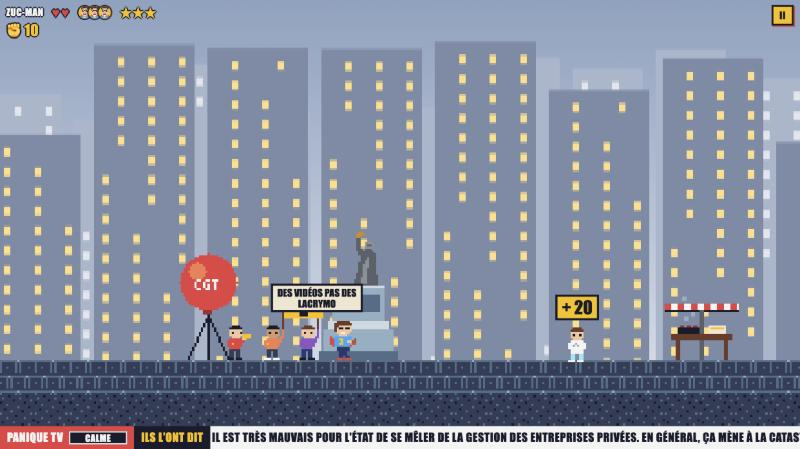 | 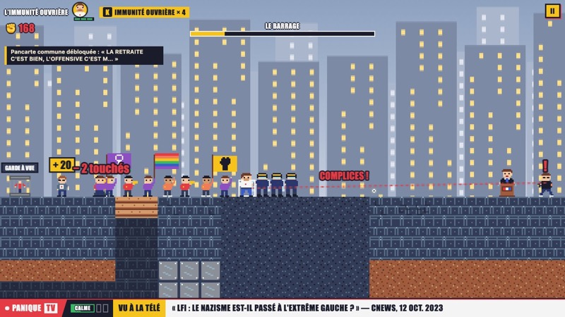 |
| 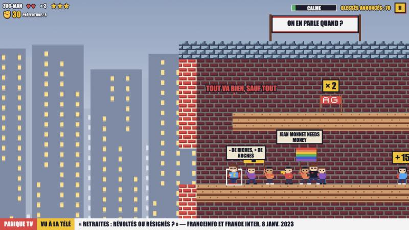 | 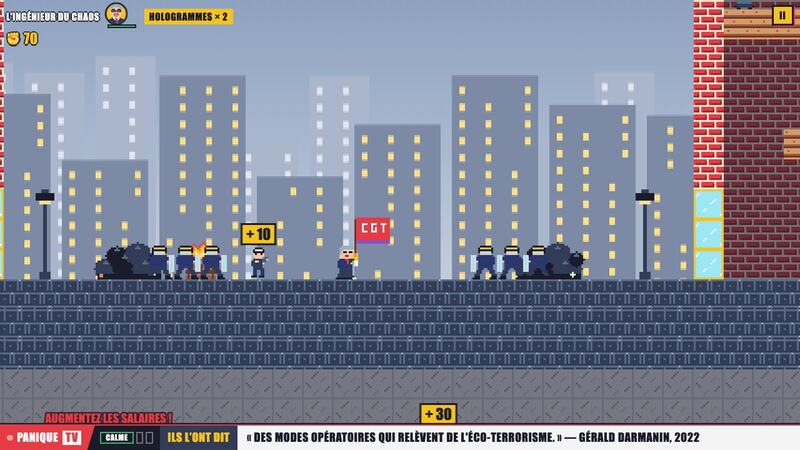 |
| 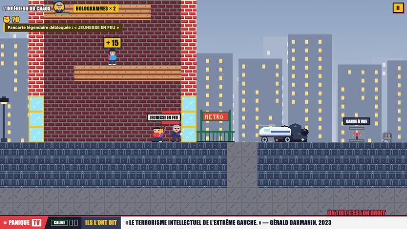 | 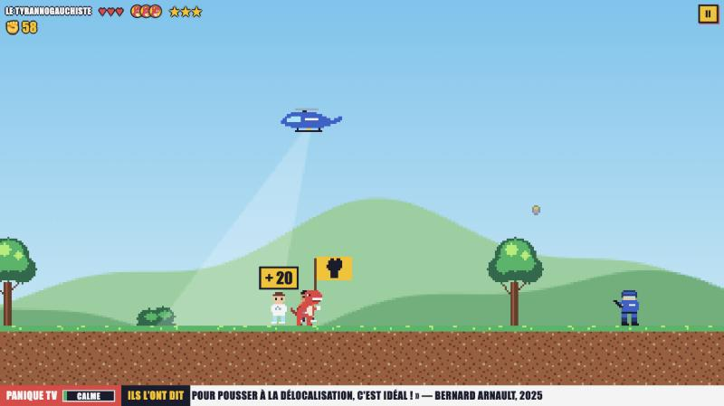 |
| 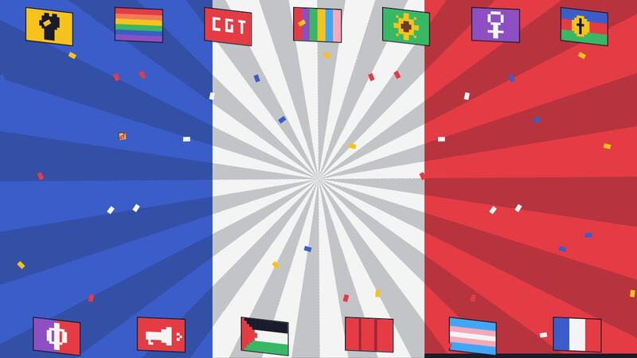 | 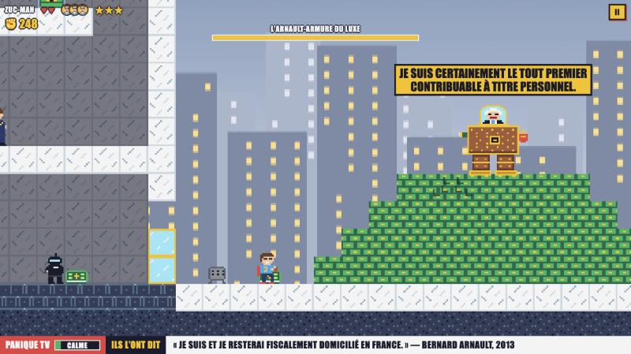 |

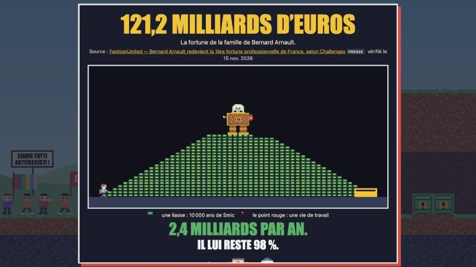

| | |
|---|---|
| 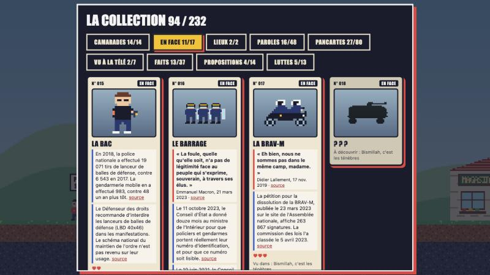 | 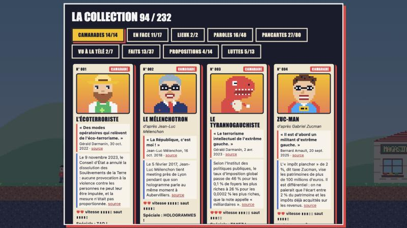 |
| 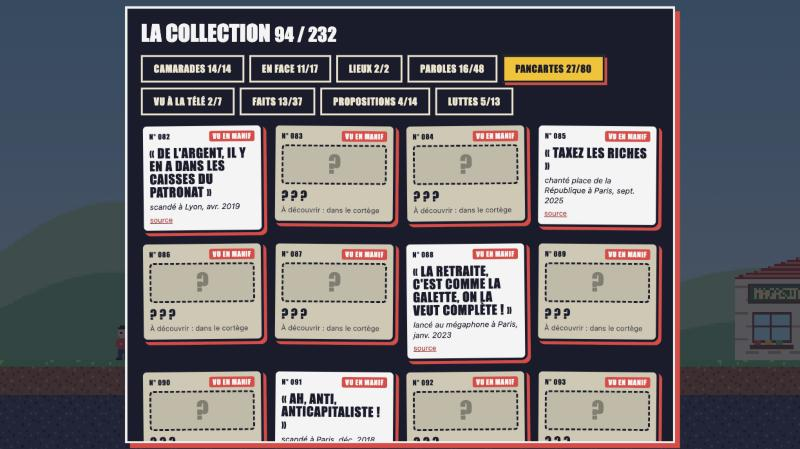 | 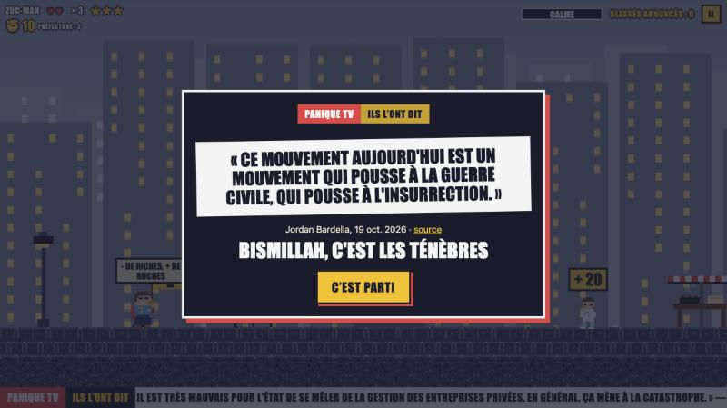 |

<details>
<summary>Plus de captures</summary>

| | |
|---|---|
| 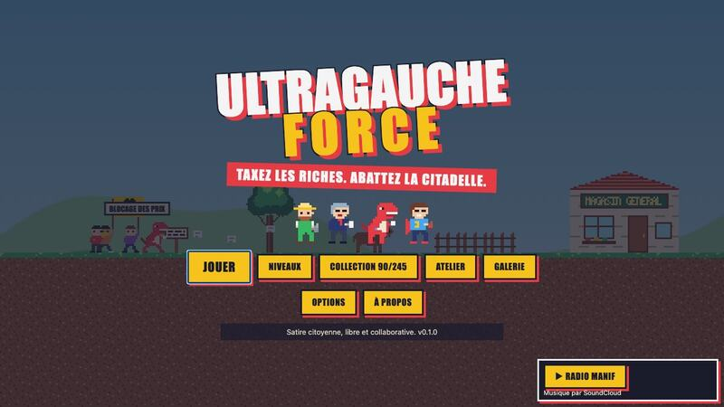 |  |
| 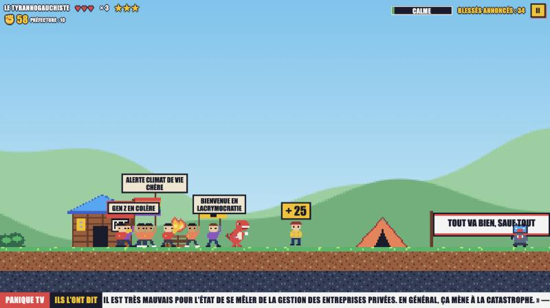 | 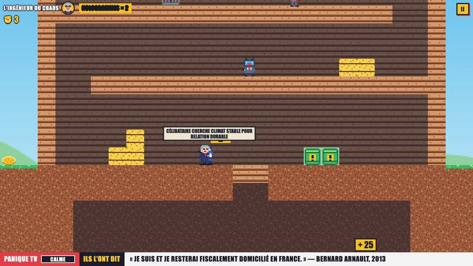 |
| 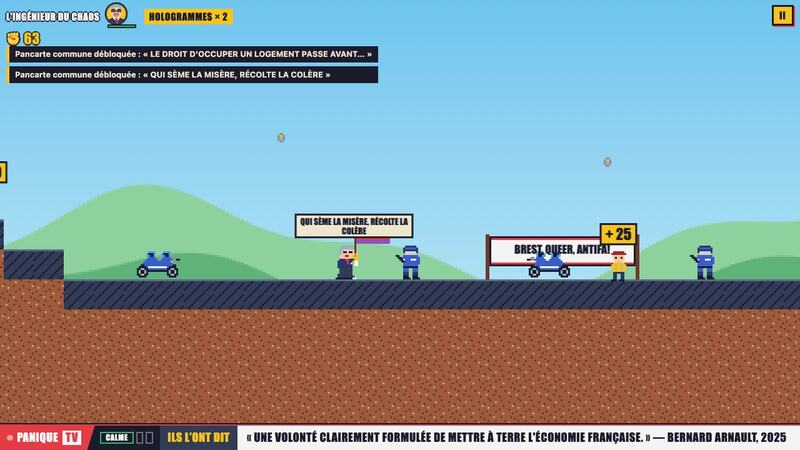 | 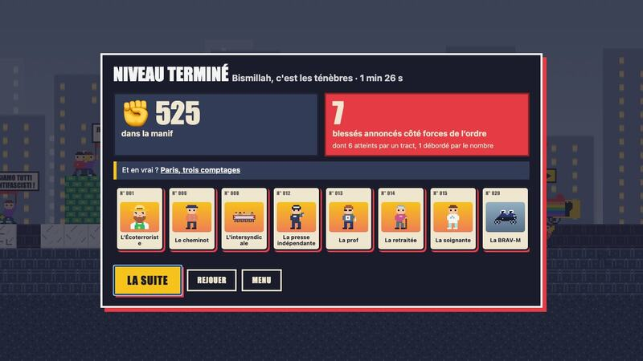 |
| 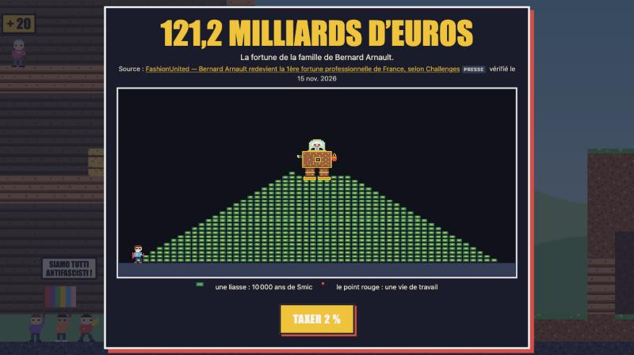 | 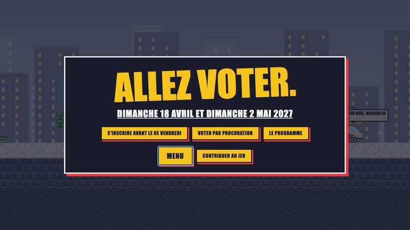 |

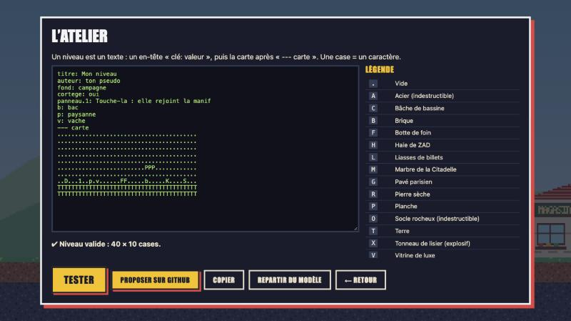

</details>

## Jouer

Pas encore en ligne. En local, il faut [Node.js](https://nodejs.org/fr) 22 et rien d'autre :

```bash
git clone https://github.com/macraoke/ultragaucheforce.git
cd ultragaucheforce
npm start
```

Le jeu est sur http://localhost:8080, la Galerie (tout le contenu, à voir et à écouter) sur http://localhost:8080/galerie.html.

| | Clavier | Manette | Tactile |
|---|---|---|---|
| Avancer | ← → ou Q D | croix ou stick | moitié gauche : glisser le pouce |
| Sauter, grimper | Espace, ↑ ou Z | A | SAUT, ou pousser le pouce gauche vers le haut |
| Tirer (maintenir) | J, X ou Entrée | X ou gâchette droite | TIR |
| Spéciale | K, C ou Maj | B ou gâchette gauche | SPÉ |
| Pause | Échap ou P | Start | II |

Sur téléphone, l'image remplit l'écran et tout l'écran répond : pas de bouton à viser. Le jeu se joue en paysage ; téléphone tenu debout, il pivote tout seul.

Contre un mur, sautez plusieurs fois : ça grimpe.

## Contribuer

Tout le contenu est en fichiers texte, modifiables depuis GitHub sans rien installer.

1. **Une idée** : [ouvrez une issue](https://github.com/macraoke/ultragaucheforce/issues/new/choose).
2. **Une ligne** : [une pancarte vue en manif, un slogan, un bandeau télé](docs/ajouter-une-blague.md), avec où, quand et le lien.
3. **Un niveau** : dessinez-le dans l'Atelier du jeu, testez, [proposez](docs/ajouter-un-niveau.md).
4. **Une fiche** : [un héros, une recrue, une unité d'en face, un boss](docs/ajouter-un-personnage.md), [un drapeau](docs/ajouter-un-drapeau.md), [un son](docs/ajouter-un-son.md), [une citation ou un chiffre sourcé](docs/ajouter-une-source.md).
5. **Une mécanique** : [une fonction dans le registre](docs/ajouter-une-mecanique.md).

Tout ce qu'on dépose devient une carte de la Collection.

Le mode d'emploi : [CONTRIBUER.md](CONTRIBUER.md).

## Sous le capot

```text
src/sim/       la simulation, pure : elle tourne aussi dans Node, pour les tests
src/content/   lecture et validation du contenu
src/client/    rendu, entrées, sons, écrans, Atelier, Galerie
content/       héros, recrues, unités, niveaux, pancartes, citations, sons… en fichiers texte
tools/         serveur local, vérification, build — zéro dépendance
```

`npm test` lance les tests, `npm run verifier` contrôle le contenu, `npm run build` fabrique la version à héberger. Le pourquoi : [docs/DECISIONS.md](docs/DECISIONS.md).

## Licence

Code [MIT](LICENSE), contenus [CC BY-SA 4.0](content/LICENCE.md). Satire citoyenne indépendante : [la charte](CHARTE.md).

## Clins d'œil

[Fiscal Kombat](https://fr.wikipedia.org/wiki/Fiscal_Kombat), l'ancêtre. [We Become What We Behold](https://ncase.itch.io/wbwwb) de Nicky Case, à qui notre drone doit tout. L'[Orchestre du Nouveau Monde](https://www.helloasso.com/associations/orchestre-du-nouveau-monde), pour la fanfare. [La Dernière](https://www.nova.fr/emissions/la-derniere/) sur Radio Nova, pour le ton. [ZzFX](https://github.com/KilledByAPixel/ZzFX) de Frank Force, pour les bruitages.
